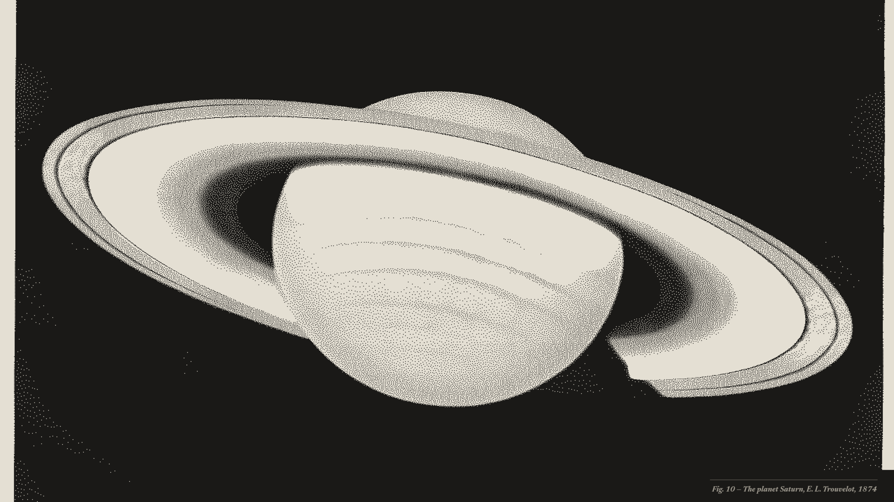

# OmaPaper Dark

The night edition of [OmaPaper](https://github.com/wstough/omarchy-omapaper-theme), an
[Omarchy](https://omarchy.org) theme that reads like a good newspaper. Warm near-black paper,
bone ink, graphite rules. Code and terminal colors are the same seven printing inks as the light
theme (crimson, vermilion, ochre, bottle green, petrol, cobalt, violet), lifted to ~7:1 contrast.



## Install

```bash
omarchy theme install https://github.com/wstough/omarchy-omapaper-dark-theme
```

## Wallpapers

Naturally dark art re-printed as halftone, pixel, grain and scratchboard-style negatives:
Julia Margaret Cameron's portraits, Nadar, Doré's London, Piranesi, Trouvelot's eclipse and Saturn,
Apollo 8's Earthrise, Muybridge, Haeckel, two tintype-style wet-plate landscapes (W. H. Jackson,
T. H. O'Sullivan), plus Omarchy's logo. See `CREDITS.md`.

The window style (rounded corners, hairline borders, soft directional shadow) and fonts are
described in the OmaPaper README; they apply to both themes.

## License

MIT for the theme; artwork per `CREDITS.md`.
